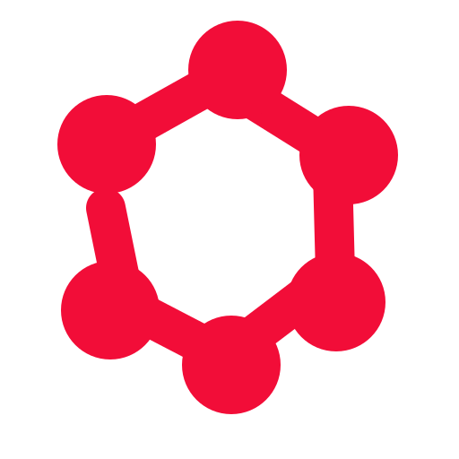

<p align="center">
  
</p>

<p align="center">
  <strong>Assistant IA libre, auto-hébergeable et conçu pour plusieurs fournisseurs.</strong>
</p>

<p align="center">
  <a href="https://github.com/AnARCHIS12/Nodalibre/releases/tag/v1.3.1"></a>
  
  
  
  
  
  
  
</p>

<p align="center">
  <em>Projet indépendant, non affilié, sponsorisé ou approuvé par un fournisseur de modèles d'IA.</em>
</p>

> [!IMPORTANT]
> Le projet change de nom et d'identité visuelle à partir de cette version.
> Les installations existantes sont migrées automatiquement ; consultez la
> section « Migration du nom » avant de mettre à jour un déploiement Docker.

---

## Aperçu

**Nodalibre** est une interface conversationnelle web inspirée des assistants IA modernes, conçue pour tourner sur un hébergement mutualisé type Hostinger ou en conteneur Docker.

Le projet utilise PHP pur, SQLite, cURL et l'API Mistral. Il inclut une installation initiale, une authentification, un historique de conversations, une rotation des clés API et une interface responsive rouge/noir.

## Fonctionnalités

- Interface chat responsive avec sidebar et historique.
- Page d'installation initiale de l'instance.
- Premier compte administrateur créé au setup.
- Authentification avec mots de passe hashes.
- Sessions stockées en base SQLite.
- Conversations et messages persistants par utilisateur.
- Catalogue Mistral actuel : Mistral Large 4, Medium 3.5, Small 4, Ministral 3 et Codestral.
- Rotation automatique des clés API partagées.
- Clé API personnelle configurable par utilisateur.
- Pool de clés Mistral serveur administrable depuis l'interface.
- Clés API internes Nodalibre (`nd_sk_...`) pour intégrer vos propres scripts.
- **Recherche dans l'historique** : recherche instantanée dans les titres et le contenu des messages.
- **Export de conversations** : export en Markdown ou JSON pour sauvegarder et partager vos discussions.
- Dictée vocale avec Voxtral Mini Transcribe 3 depuis le champ de message.
- Discussion vocale avec réponse audio Mistral ou voix locale du navigateur en fallback.
- Recherche web avec routage automatique vers les modèles compatibles connecteurs.
- Analyse OCR avec **fallback automatique Vision Multimodale** en cas de limite de quota sur `/v1/ocr`.
- Génération d'images via les Agents Mistral et l'outil `image_generation`.
- Interface multilingue : français, anglais, espagnol, allemand et italien.
- Prévisualisation directe des blocs HTML/CSS/JS/SVG dans un panneau intégré.
- Workspace utilisateur pour coder et sauvegarder localement les blocs générés.
- Suivi de la consommation avec affichage des jetons (tokens) utilisés par réponse de l'IA.
- Connexion GitHub par dépôt, branche et token optionnel pour afficher l'arborescence du repo.
- Connexion GitHub OAuth : l'utilisateur autorise l'app, puis choisit un dépôt accessible.
- Création de dépôts GitHub depuis le workspace.
- Ajout ou modification de fichiers GitHub avec commit direct depuis l'interface.
- Envoi de plusieurs fichiers GitHub en un seul commit depuis un tableau JSON.
- Rendu Markdown des réponses.
- Assets de marque inclus : logo clair, logo sombre et icône.
- Compatible hébergement mutualisé : pas de `exec`, pas de `shell_exec`, pas de `putenv`.

## Capacités IA

Nodalibre regroupe plusieurs fonctions dans une seule interface :

| Fonction | Interface | Backend |
| --- | --- | --- |
| Chat texte | Champ principal | Chat completions Mistral (`mistral-small-latest` par défaut) |
| Recherche web | Bouton globe | Conversations API avec connecteur web (`mistral-small-latest`) |
| Dictée vocale | Bouton micro | Voxtral transcription (`voxtral-mini-transcribe-3`) |
| Discussion vocale | Bouton téléphone | Transcription + réponse audio |
| OCR / documents | Bouton fichier | `mistral-ocr-latest` + Fallback Vision Multimodale (`ministral-14b-latest`) |
| Génération d'images | Bouton baguette ou demande dans le chat | Agent Mistral + `image_generation` |

### Modèles Mistral supportés

La disponibilité et la facturation dépendent du niveau du compte Mistral utilisé :

| Modèle affiché | ID Technique | Description |
| --- | --- | --- |
| **Mistral Large 4** | `mistral-large-4` | Généraliste multimodal, contexte 1M, Public Preview |
| **Mistral Medium 3.5** | `mistral-medium-latest` | Raisonnement, agents et code |
| **Mistral Small 4** ⭐ *(Défaut)* | `mistral-small-latest` | Modèle rapide et multimodal |
| **Ministral 3 14B** | `ministral-14b-latest` | Modèle multimodal équilibré |
| **Ministral 3 8B** | `ministral-8b-latest` | Modèle multimodal léger |
| **Ministral 3 3B** | `ministral-3b-latest` | Modèle multimodal compact |
| **Codestral** | `codestral-latest` | Génération et complétion de code |
| **Codestral 25.08** | `codestral-2508` | Version épinglée de Codestral |

Pour générer une image, vous pouvez cliquer sur le bouton baguette ou écrire directement dans le chat :

```text
génère un chat anarchiste en affiche rouge et noir
```

Nodalibre détecte les demandes d'image courantes (`génère une image`, `dessine`, `crée une affiche`, etc.) et les route vers l'agent image au lieu du chat texte.

> La génération d'images dépend de l'accès de votre compte Mistral aux Agents et à l'outil `image_generation`. Si votre compte n'y a pas accès, l'interface affichera l'erreur retournée par Mistral.

## Captures / Branding

| Logo sombre | Logo clair | Icône |
| --- | --- | --- |
|  |  |  |

## Prérequis

- PHP 8.3 ou plus récent.
- Extension PHP `pdo_sqlite`.
- Extension PHP `curl`.
- Un serveur Apache ou compatible PHP.
- Une ou plusieurs clés API Mistral.

## Installation

1. Envoyez tous les fichiers dans le dossier web de votre hébergement, par exemple `public_html/`.
2. Vérifiez que PHP peut créer les dossiers `data/` et `sandbox/`.
3. Ouvrez votre domaine dans le navigateur.
4. Si aucun compte n'existe, Nodalibre redirige automatiquement vers `setup.php`.
5. Créez le compte administrateur et ajoutez les clés Mistral partagées si besoin.
6. Connectez-vous et commencez une conversation.

## Installation Docker

Nodalibre peut aussi tourner dans une image Docker Apache + PHP.

### Installation one-line interactive

Installation moderne depuis GitHub avec `curl` :

```bash
curl -fsSL https://raw.githubusercontent.com/AnARCHIS12/Nodalibre/main/install.sh | sh
```

Le script lance un assistant interactif :

```text
Dossier d'installation [/home/user/nodalibre]:
Port web local [8173]:
Image Docker [liberchat/nodalibre:latest]:
Configurer GitHub OAuth maintenant ? [o/N]
Lancer Nodalibre après l'installation ? [O/n]
Continuer ? [O/n]
```

Si Docker est absent, l'installateur propose de l'installer automatiquement :

- Linux : installation de Docker Engine via le script officiel Docker, activation du service et ajout de l'utilisateur au groupe `docker` si possible.
- macOS : installation de Docker Desktop via Homebrew si `brew` est disponible.
- Le `PATH` est corrigé automatiquement quand Docker existe dans un chemin standard.

Version avec URL GitHub classique :

```bash
curl -fsSL https://github.com/AnARCHIS12/Nodalibre/raw/main/install.sh | sh
```

Afficher l'aide :

```bash
curl -fsSL https://raw.githubusercontent.com/AnARCHIS12/Nodalibre/main/install.sh | sh -s -- --help
```

Changer le port sans passer par les questions :

```bash
curl -fsSL https://raw.githubusercontent.com/AnARCHIS12/Nodalibre/main/install.sh | sh -s -- --port 8080
```

Installer dans un dossier précis :

```bash
curl -fsSL https://raw.githubusercontent.com/AnARCHIS12/Nodalibre/main/install.sh | sh -s -- --dir /opt/nodalibre
```

Installation automatique sans interaction :

```bash
curl -fsSL https://raw.githubusercontent.com/AnARCHIS12/Nodalibre/main/install.sh | \
  NODALIBRE_YES=1 \
  NODALIBRE_PORT=8080 \
  sh
```

Préparer les fichiers sans démarrer Docker :

```bash
curl -fsSL https://raw.githubusercontent.com/AnARCHIS12/Nodalibre/main/install.sh | sh -s -- --no-start
```

Refuser l'installation automatique de Docker :

```bash
curl -fsSL https://raw.githubusercontent.com/AnARCHIS12/Nodalibre/main/install.sh | sh -s -- --no-install-docker
```

Avec OAuth GitHub dès l'installation :

```bash
curl -fsSL https://raw.githubusercontent.com/AnARCHIS12/Nodalibre/main/install.sh | \
  NODALIBRE_YES=1 \
  GITHUB_OAUTH_CLIENT_ID=votre_client_id \
  GITHUB_OAUTH_CLIENT_SECRET=votre_client_secret \
  GITHUB_OAUTH_SCOPE=repo \
  sh
```

### Installation Windows PowerShell

Depuis PowerShell, lancez l'installateur interactif Windows :

```powershell
irm https://raw.githubusercontent.com/AnARCHIS12/Nodalibre/main/install.ps1 | iex
```

Le script demande :

```text
Dossier d'installation [~\nodalibre]
Port web local [8173]
Image Docker [liberchat/nodalibre:latest]
Configurer GitHub OAuth maintenant ? [o/N]
Lancer Nodalibre après l'installation ? [O/n]
Continuer ? [O/n]
```

Si Docker Desktop ou WSL sont absents, le script configure automatiquement WSL 2, installe Docker Desktop avec `winget`, configure le `PATH`, attend que le moteur Docker soit prêt et démarre l'application.

Avec options, téléchargez puis lancez le script :

```powershell
irm https://raw.githubusercontent.com/AnARCHIS12/Nodalibre/main/install.ps1 -OutFile install.ps1
powershell -ExecutionPolicy Bypass -File .\install.ps1 -Port 8080 -Dir "$env:USERPROFILE\Nodalibre"
```

Installation automatique sans questions :

```powershell
powershell -ExecutionPolicy Bypass -File .\install.ps1 -Yes -Port 8080
```

Refuser l'installation automatique de Docker Desktop :

```powershell
powershell -ExecutionPolicy Bypass -File .\install.ps1 -NoInstallDocker
```

Préparer les fichiers sans démarrer Docker :

```powershell
powershell -ExecutionPolicy Bypass -File .\install.ps1 -NoStart
```

Tester la configuration sans rien écrire :

```powershell
powershell -ExecutionPolicy Bypass -File .\install.ps1 -DryRun -Yes
```

Le script crée :

```text
~/nodalibre/
├── docker-compose.yml
├── .env
├── data/
└── sandbox/
```

Puis il lance directement l'image :

```text
liberchat/nodalibre:latest
```

### Lancement rapide avec Docker Compose

1. Copiez le fichier d'environnement :

```bash
cp .env.example .env
```

2. Renseignez OAuth GitHub dans `.env` si vous voulez activer `Se connecter avec GitHub` :

```env
PUBLIC_URL=https://votre-domaine.com
GITHUB_OAUTH_CLIENT_ID=votre_client_id
GITHUB_OAUTH_CLIENT_SECRET=votre_client_secret
GITHUB_OAUTH_SCOPE=
MISTRAL_API_KEYS=votre_cle_mistral
MISTRAL_WEB_SEARCH_TOOL=web_search
MISTRAL_OCR_MODEL=mistral-ocr-latest
MISTRAL_TRANSCRIPTION_MODEL=voxtral-mini-transcribe-3
MISTRAL_IMAGE_MODEL=mistral-medium-latest
MISTRAL_IMAGE_AGENT_ID=
MISTRAL_TTS_MODEL=voxtral-mini-tts-3-0
MISTRAL_TTS_VOICE_ID=
```

3. Construisez et lancez :

```bash
docker compose up -d --build
```

4. Ouvrez :

```text
http://127.0.0.1:8173
```

Les dossiers `data/` et `sandbox/` sont montés en volume local, donc la base SQLite reste persistante entre les redémarrages.

### Build image Docker

```bash
docker build -t nodalibre:local .
```

Lancer l'image :

```bash
docker run -d \
  --name nodalibre \
  -p 8173:80 \
  -v "$PWD/data:/var/www/html/data" \
  -v "$PWD/sandbox:/var/www/html/sandbox" \
  -e PUBLIC_URL="https://votre-domaine.com" \
  -e GITHUB_OAUTH_CLIENT_ID="votre_client_id" \
  -e GITHUB_OAUTH_CLIENT_SECRET="votre_client_secret" \
  nodalibre:local
```

### Push vers Docker Hub

Remplacez `votre-compte` par votre compte Docker Hub :

```bash
docker login
docker build -t votre-compte/nodalibre:latest .
docker push votre-compte/nodalibre:latest
```

Build et push multi-architecture `linux/amd64` + `linux/arm64` :

```bash
docker run --privileged --rm tonistiigi/binfmt --install arm64,amd64
docker buildx create --name nodalibre-multi --driver docker-container --use --bootstrap
docker buildx build \
  --builder nodalibre-multi \
  --platform linux/amd64,linux/arm64 \
  -t votre-compte/nodalibre:latest \
  --push .
```

Vérifier les architectures publiées :

```bash
docker buildx imagetools inspect votre-compte/nodalibre:latest
```

Versionner une release :

```bash
docker tag votre-compte/nodalibre:latest votre-compte/nodalibre:v1.3.1
docker push votre-compte/nodalibre:v1.3.1
```

### Déploiement production avec l'image publiée

Le fichier `docker-compose.prod.yml` utilise directement l'image Docker Hub :

```yaml
image: liberchat/nodalibre:latest
```

Lancer en production :

```bash
cp .env.example .env
docker compose -f docker-compose.prod.yml pull
docker compose -f docker-compose.prod.yml up -d
```

Mettre à jour :

```bash
docker compose -f docker-compose.prod.yml pull
docker compose -f docker-compose.prod.yml up -d
```

Les données SQLite et le sandbox sont persistés dans des volumes Docker nommés :

```text
nodalibre_data
nodalibre_sandbox
```

### Push vers GitHub Container Registry

Connectez-vous à GHCR avec un token GitHub ayant le droit `write:packages` :

```bash
echo "VOTRE_TOKEN_GITHUB" | docker login ghcr.io -u VOTRE_USER_GITHUB --password-stdin
docker build -t ghcr.io/VOTRE_USER_GITHUB/nodalibre:latest .
docker push ghcr.io/VOTRE_USER_GITHUB/nodalibre:latest
```

Lancer l'image GHCR :

```bash
docker run -d \
  --name nodalibre \
  -p 8173:80 \
  -v "$PWD/data:/var/www/html/data" \
  -v "$PWD/sandbox:/var/www/html/sandbox" \
  ghcr.io/VOTRE_USER_GITHUB/nodalibre:latest
```

## Configuration

Les constantes principales se trouvent dans `config.php`.

```env
MISTRAL_API_KEYS=votre_cle_1,votre_cle_2
```

Les clés ajoutées dans `setup.php` sont stockées en base dans `app_settings` et sont utilisées en priorité. Si aucune clé n'est configurée dans l'instance, Nodalibre utilise `DEFAULT_MISTRAL_API_KEYS`.

### GitHub OAuth

Pour éviter de coller un token GitHub manuellement, créez une OAuth App GitHub.

### Créer l'OAuth App GitHub

1. Ouvrez GitHub.
2. Allez dans `Settings`.
3. Ouvrez `Developer settings`.
4. Ouvrez `OAuth Apps`.
5. Cliquez `New OAuth App`.
6. Renseignez :

```text
Application name: Nodalibre
Homepage URL: http://127.0.0.1:8173
Authorization callback URL: http://127.0.0.1:8173/github_oauth.php
```

En production, remplacez `http://127.0.0.1:8173` par votre domaine :

```text
Homepage URL: https://votre-domaine.com
Authorization callback URL: https://votre-domaine.com/github_oauth.php
```

7. Cliquez `Register application`.
8. Copiez le `Client ID`.
9. Cliquez `Generate a new client secret`.
10. Copiez le `Client Secret`.

### Activer OAuth sans Docker

Renseignez ensuite `config.php` :

```php
define('PUBLIC_URL', 'https://votre-domaine.com');
define('GITHUB_OAUTH_CLIENT_ID', 'votre_client_id');
define('GITHUB_OAUTH_CLIENT_SECRET', 'votre_client_secret');
define('GITHUB_OAUTH_SCOPE', '');
```

### Activer OAuth avec Docker

Renseignez `.env` :

```env
PUBLIC_URL=https://votre-domaine.com
GITHUB_OAUTH_CLIENT_ID=votre_client_id
GITHUB_OAUTH_CLIENT_SECRET=votre_client_secret
GITHUB_OAUTH_SCOPE=
```

`PUBLIC_URL` force l'URL publique utilisée pour OAuth. Elle est recommandée derrière un reverse proxy HTTPS, par exemple Dockhand, Traefik, Nginx Proxy Manager ou Cloudflare Tunnel.

`GITHUB_OAUTH_SCOPE` peut rester vide. Nodalibre detecte les GitHub Apps dont le `Client ID` commence par `Iv` et n'envoie pas de scope, car leurs permissions sont gerees dans la GitHub App. Pour une OAuth App classique, utilisez `repo` si vous voulez acceder aux depots prives.

### Variables Mistral optionnelles

| Variable | Défaut | Usage |
| --- | --- | --- |
| `MISTRAL_API_KEYS` | vide | Clés Mistral serveur séparées par des virgules ou des retours à la ligne. |
| `MISTRAL_WEB_SEARCH_TOOL` | `web_search` | Outil de recherche web utilisé par Conversations API. |
| `MISTRAL_OCR_MODEL` | `mistral-ocr-latest` | Modèle OCR pour les images et documents. |
| `MISTRAL_IMAGE_MODEL` | `mistral-medium-latest` | Modèle de l'agent qui pilote la génération d'image. |
| `MISTRAL_IMAGE_AGENT_ID` | vide | Agent Mistral existant avec `image_generation`. Si vide, Nodalibre essaie d'en créer un automatiquement. |
| `MISTRAL_TTS_MODEL` | `voxtral-mini-tts-3-0` | Modèle de synthèse vocale. |
| `MISTRAL_TTS_VOICE_ID` | vide | Voix Mistral à utiliser. Si vide ou indisponible, le navigateur peut lire la réponse en fallback. |

Pour une production stable, créez un Agent Mistral avec l'outil `image_generation`, puis renseignez son identifiant dans `MISTRAL_IMAGE_AGENT_ID`.

Puis relancez :

```bash
docker compose up -d --build
```

Après ça, le bouton `Se connecter avec GitHub` apparaît dans le Workspace. L'utilisateur autorise Nodalibre, puis choisit un dépôt accessible.

## Structure

```text
votre-domaine.com/
├── index.php                         Interface principale
├── setup.php                         Installation initiale
├── login.php                         Connexion
├── register.php                      Inscription
├── logout.php                        Déconnexion
├── settings.php                      Paramètres utilisateur
├── admin_keys.php                    Pool de clés Mistral serveur
├── api_tokens.php                    Clés API internes Nodalibre
├── workspace.php                     Workspace code et connexion GitHub
├── workspace_api.php                 API de sauvegarde des blocs de code
├── chat.php                          API de chat
├── transcribe.php                    API dictée vocale Voxtral
├── speak.php                         API réponse vocale
├── ocr.php                           API OCR et analyse de documents
├── image_generate.php                API génération d'images
├── conversations.php                 API conversations
├── auth.php                          Authentification
├── i18n.php                          Traductions multilingues
├── config.php                        Configuration globale
├── database.php                      Accès SQLite et schéma
├── mistral.php                        Client API Mistral
├── github_oauth.php                  Callback OAuth GitHub
├── install.sh                        Installateur one-line curl
├── install.ps1                       Installateur Windows PowerShell
├── Dockerfile                        Image Docker Apache + PHP
├── docker-entrypoint.sh              Préparation permissions Docker
├── docker-compose.yml                Lancement Docker local
├── docker-compose.prod.yml           Lancement production avec image publiée
├── .env.example                      Variables Docker exemple
├── LICENSE                           Licence MIT
├── nodalibre-logo-dark.svg        Logo sombre, source vectorielle
├── nodalibre-logo-light.svg       Logo clair, source vectorielle
├── nodalibre-logo-dark.png        Logo sombre
├── nodalibre-logo-light.png       Logo clair
├── nodalibre-icon.svg             Icône, source vectorielle
├── nodalibre-icon.png             Icône / favicon
└── data/
    ├── nodalibre.sqlite           Base créée automatiquement
    └── nodalibre.log              Logs applicatifs
```

## Base de données

La base SQLite est créée automatiquement au premier accès :

```text
data/nodalibre.sqlite
```

Tables principales :

- `users`
- `sessions`
- `conversations`
- `messages`
- `app_settings`
- `api_tokens`

## Clés Mistral et clés internes

Nodalibre sépare deux types de secrets :

- **Clés Mistral serveur** : clés du fournisseur, visibles uniquement par l'admin dans `admin_keys.php`.
- **Clés Nodalibre** : tokens internes générés dans `api_tokens.php`, au format `nd_sk_...`.

Les tokens internes permettent d'appeler votre interface comme une API sans partager la clé Mistral réelle :

```bash
curl https://votre-domaine.com/chat.php \
  -H 'Authorization: Bearer nd_sk_votre_clé' \
  -H 'Content-Type: application/json' \
  -d '{"message":"Bonjour Nodalibre","model":"mistral-small-latest"}'
```

La réponse contient un `conversation_id`. Pour continuer le même fil :

```bash
curl https://votre-domaine.com/chat.php \
  -H 'Authorization: Bearer nd_sk_votre_clé' \
  -H 'Content-Type: application/json' \
  -d '{"conversation_id":1,"message":"Continue","model":"mistral-small-latest"}'
```

Le serveur vérifie la clé `nd_sk_...`, retrouve l'utilisateur associé, crée ou charge sa conversation, puis appelle l'API avec le pool de clés serveur ou la clé personnelle de l'utilisateur. Les jetons historiques restent acceptés pour éviter une coupure lors de la migration.

## Compatibilité Hostinger

- cURL uniquement pour les appels HTTP.
- SQLite local, sans service MySQL obligatoire.
- Chemins basés sur `dirname(__FILE__)`.
- Dossiers créés automatiquement en permissions `0755`.
- Aucun appel système interdit en mutualisé.
- Polices système, sans import Google Fonts.

## Sécurité

- Hash des mots de passe via `password_hash`.
- Protection contre les tentatives de connexion répétée.
- Sessions persistantes en base.
- Clé API personnelle stockée par utilisateur.
- Logs applicatifs séparés dans `data/nodalibre.log`.

## Migration du nom

Au premier lancement, Nodalibre détecte et renomme automatiquement l'ancienne
base SQLite et son journal. Sauvegardez néanmoins le dossier `data/` avant la
mise à jour. Les anciens jetons API internes continuent de fonctionner ; les
nouveaux jetons utilisent le préfixe `nd_sk_`.

Les identifiants Docker ont changé pour `nodalibre`, `nodalibre_data` et
`nodalibre_sandbox`. Si vous utilisiez des volumes nommés, rattachez explicitement
les volumes existants ou copiez leur contenu avant de recréer le conteneur.

## Remerciements

Merci à [LaurentVoanh](https://github.com/LaurentVoanh) pour ce projet génial.

## Licence

Nodalibre est distribué sous licence **MIT**.

Vous pouvez l'utiliser, le modifier, le redistribuer et l'auto-héberger librement, à condition de conserver la notice de licence. Voir le fichier [LICENSE](LICENSE).
